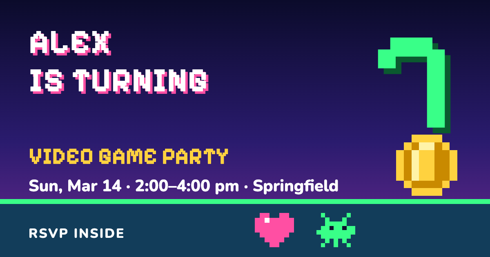
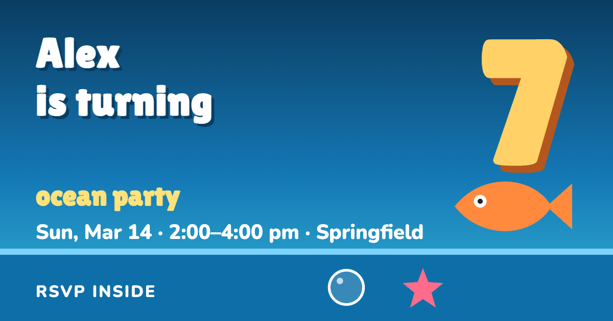
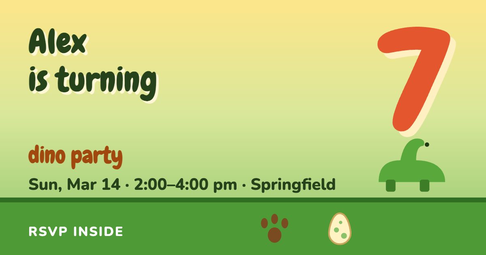
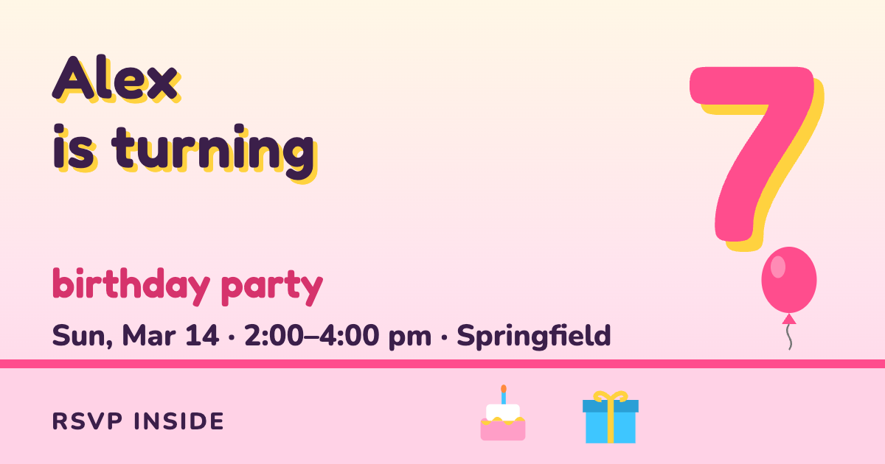
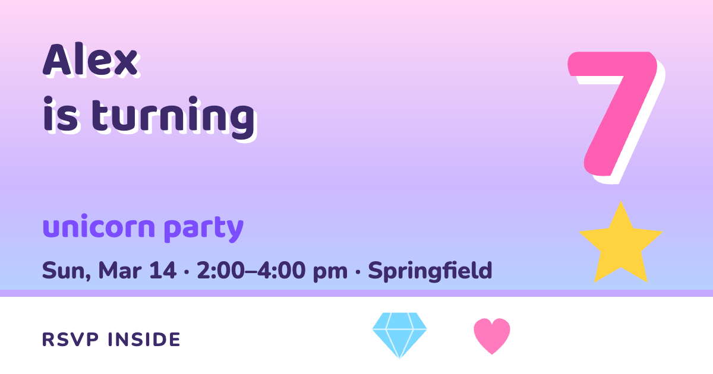

# party-invitation

A themed party invitation with RSVPs, a guest-list admin page, and optional email notifications. It runs entirely on [Cloudflare](https://www.cloudflare.com/) (Workers + D1), and the free plan is enough for a birthday party.

Guests get one link to text or email. They see the invitation, add it to their calendar, and RSVP from their phone. You get a private page that shows who's coming, how many kids, food preferences and allergies, and you can edit or delete responses.

| | | |
|---|---|---|
|  **arcade** |  **space** |  **ocean** |
|  **dino** |  **confetti** |  **magic** |

(The images above are the link previews guests see in iMessage, WhatsApp, Slack and email. Alex and the address are made up.)

## Live demo

A static demo lets people flip between all six themes, send a test RSVP, and use the real admin page. A bar at the top switches themes and keeps your scroll position. It has no server: a small script in the page pretends to be the backend, with a few made-up guests stored only in the visitor's own browser. Nothing is shared between visitors or sent anywhere. The admin passphrase in the demo is `demo`, and a "Reset demo data" button starts over.

```bash
npm run build:demo        # writes demo/
npx wrangler dev --config wrangler.demo.jsonc    # or any static file server, to look at it
```

The demo always builds from `scripts/demo.config.json` (the fictional "Alex"), never from your `event.config.json`, so your real party details can't end up in it.

**Host it on GitHub Pages (free).** Make the repository public, then go to **Settings → Pages → Source: GitHub Actions**. The included workflow (`.github/workflows/demo.yml`) rebuilds and publishes the demo on every push to `main`, at `https://<you>.github.io/<repo>/`. (Pages on a private repository needs a paid GitHub plan.)

**Or host it on Cloudflare (free).** `npm run deploy:demo` publishes it as its own static site, `party-invitation-demo`, with no database or secrets.

**What you get**

- Six themes with parallax backgrounds and playful animation (and full support for "reduce motion").
- RSVP form: child names, parent name, yes/no, how many kids, staying or dropping off, optional food choices and allergies.
- Re-submitting the same names updates the earlier answer.
- Calendar buttons for Apple/Outlook (`.ics`) and Google Calendar, with correct times across daylight-saving changes.
- Link previews built for iMessage: the preview tags are in the page's static HTML, and the preview image is generated for you.
- Admin page behind a passphrase: totals, per-food counts, edit, soft delete with a Deleted tab, restore, and permanent delete with a countdown. It works well on a phone.
- Optional email notification for each RSVP.

## Quick start

You need: [Node.js](https://nodejs.org/) 20 or newer, a free [Cloudflare account](https://dash.cloudflare.com/sign-up), and Google Chrome or Microsoft Edge installed (used once to draw the link-preview image).

### 1. Get the code

```bash
git clone https://github.com/<you>/party-invitation.git
cd party-invitation
npm install
```

### 2. Describe your party

Open `event.config.json` and change the example. The important fields:

| Field | What it does |
|---|---|
| `theme` | `arcade`, `space`, `ocean`, `dino`, `confetti` or `magic` |
| `honoree`, `age` | Headline: "Alex is turning 7". Leave out `age` (or use `null`) for a plain "Alex's party" headline |
| `partyType` | Used in the subtitle and preview, e.g. `"video game party"`, `"pool party"` |
| `date`, `start`, `end`, `timezone` | `2027-03-14`, `14:00`, `16:00`, and an [IANA timezone](https://en.wikipedia.org/wiki/List_of_tz_database_time_zones) like `America/New_York` |
| `venueName`, `address` | Shown on the page; the address links to Google Maps |
| `locationShort` | Just the town, e.g. `"Springfield"`. Used in link previews so your full address isn't in them |
| `plan` | The schedule, as `{ "time": "15:30", "text": "Pizza and cake." }` |
| `note` | A line under the schedule. `{end}` becomes the end time |
| `food` | A list of choices ("Cheese", "Pepperoni"...), or remove the field to skip the question |
| `maxKids` | Highest number in the "how many kids" dropdown (max 10) |
| `siteUrl` | Your live address. Fill this in after the first deploy (see step 4) |
| `notify` | Optional email notifications (see [below](#email-notifications-optional)) |
| `copy` | Override any wording, such as the kicker, button text, or confirmation messages |

### 3. Try it on your computer

```bash
cp .dev.vars.example .dev.vars    # sets a local admin passphrase
npm run dev
```

Open <http://localhost:8787>. The admin page is at <http://localhost:8787/admin> (passphrase from `.dev.vars`). Local RSVPs go into a throwaway local database.

### 4. Put it online

```bash
npx wrangler login                          # opens your browser, once
npx wrangler d1 create party-rsvps          # creates the database; prints a database_id
```

Copy the printed `database_id` into `wrangler.jsonc` (replace `REPLACE_WITH_YOUR_D1_ID`), then:

```bash
npm run db:migrate                          # creates the table in your database
npx wrangler secret put ADMIN_PASSPHRASE    # type a passphrase; it's stored as a Cloudflare secret
npm run deploy                              # builds the site, draws the preview image, deploys
```

Wrangler prints your address, something like `https://party-invitation.<your-subdomain>.workers.dev`.

**Now set `siteUrl`.** Put that address in `event.config.json` (`"siteUrl": "https://party-invitation.<your-subdomain>.workers.dev"`) and run `npm run deploy` once more. Link previews need absolute URLs, so without this the card won't show the image in messaging apps.

Your guest list is at `<your address>/admin`.

### 5. Test the preview, then send it

Text your invitation link to yourself and check the card shows the image, title and description. Then send it to everyone. iMessage and other apps remember the first preview they see for a link, so do this test before the real send. The image file name changes automatically whenever the design changes, so a redesign gets a fresh preview.

## Themes

| Theme | Look |
|---|---|
| `arcade` | 8-bit video game night: pixel font, coins, aliens, controllers |
| `space` | Rockets, ringed planets and a moonlit horizon |
| `ocean` | Bubbles, fish and rolling waves |
| `dino` | A sunny jungle with dinosaurs, eggs and a volcano |
| `confetti` | Classic birthday: balloons, bunting, cake, falling confetti |
| `magic` | Pastel skies, rainbows and sparkles |

Change `"theme"` in `event.config.json` and update `partyType` to match (`"space party"`, `"dino party"`...). Each theme is one small file in `themes/`: colours, fonts, the parallax layers, a few sprites and a little flavour text. To make your own, copy the closest one, rename it, and edit. `npm run check` will tell you if your colours are readable (see [Checking your changes](#checking-your-changes)).

## Custom domain (optional)

The free `workers.dev` address works fine. A custom domain looks nicer in a text message, and it's required for email notifications.

1. Your domain's DNS needs to be on Cloudflare (add the site in the Cloudflare dashboard).
2. Dashboard → **Workers & Pages** → your worker → **Settings** → **Domains & Routes** → **Add** → **Custom domain**. A subdomain such as `party.example.com` is the easy choice.
3. Set `siteUrl` in `event.config.json` to the new address and run `npm run deploy`.

If the domain already has a Redirect Rule (Rules → Redirect Rules), it runs before your Worker. Edit it to skip your invitation's host or path.

**What about GitHub Pages?** It's free, but it only serves static files, and the RSVP form needs a server and a database. Splitting the invitation (Pages) from the API (a Worker) is possible, but this template doesn't set that up for you. It would need cross-origin (CORS) handling and an API address in the page. The Workers-only setup above is simpler and is what's supported.

## Email notifications (optional)

Get an email each time someone RSVPs. This needs a custom domain on Cloudflare (a `workers.dev` address can't send mail).

1. **Turn on Email Routing** for your domain: dashboard → your domain → **Email** → **Email Routing** → onboard the domain. Cloudflare adds the mail DNS records for you.
2. **Verify each person who should get the email:** Email Routing → **Destination addresses** → add the address. They'll receive a confirmation link and must click it. Cloudflare only sends to verified addresses on the free plan.
3. **Allow the Worker to send.** In `wrangler.jsonc`, add this line next to `d1_databases`:

   ```jsonc
   "send_email": [{ "name": "EMAIL" }],
   ```

4. In `event.config.json`:

   ```json
   "notify": {
     "to": ["you@example.com", "partner@example.com"],
     "from": "rsvp@party.example.com"
   }
   ```

   `from` must be an address at the domain you set up in step 1. It doesn't need to be a real mailbox.
5. Run `npm run deploy`, then submit a test RSVP from your invitation (and delete it from the admin page).

Things to know:

- If one address in `to` isn't verified, the send can fail for everyone. Verify them all first.
- Sending to arbitrary (unverified) addresses is a paid Workers feature. This template only needs the free, verified-address route.
- A notification failing never stops an RSVP from saving.

## The admin page

`/admin` asks for the passphrase you stored with `wrangler secret put ADMIN_PASSPHRASE`. To change it later, run that command again. This is a simple shared passphrase meant to keep a party guest list private, not bank-grade security.

- **Delete** moves a response to the **Deleted** tab (restorable at any time).
- **Delete forever**, in the Deleted tab, starts a 5-second countdown you can cancel.
- **Edit** opens every field. If a parent re-submits the form with the same names, it updates their existing answer, even if you'd deleted it.

## Checking your changes

```bash
npm run check             # builds every theme and tests it in a real browser at phone size
npm run check -- ocean    # just one theme
```

It checks things that matter on phones: nothing scrolls sideways, pinch-zoom is locked while pull-to-refresh still works, the RSVP button never adds `#something` to the URL, the name field gets focus, "reduce motion" is respected, text stays readable (colour contrast), names are Title Cased, and the confirmation copy works for one child or several.

It also builds the demo and tests it the way GitHub Pages serves it (under a sub-path): the theme switcher, a test RSVP, and the demo admin page.

Other scripts: `npm run build` (render `dist/`), `npm run build:fast` (skip the preview image), `npm run typecheck`.

## How it works

```
event.config.json     your party
themes/<theme>.mjs    colours, fonts, parallax layers, sprites, flavour text
src/template/         shared page layout, styles and script (themes plug into these)
scripts/build.mjs     renders dist/ (static HTML/CSS/JS, calendar file, preview image)
src/worker.ts         the API: RSVP, admin login, edit/delete/restore
scripts/build-demo.mjs  the static demo (themes + switcher + fake in-browser backend, src/demo/)
migrations/           the database table
```

The invitation is static HTML, which is what link-preview crawlers need. They don't run JavaScript, so the title, description and image tags are written into the page at build time. The Worker handles only `/api/*`; Cloudflare serves everything else straight from `dist/`.

## Good to know

- One event per deployment. For a second party, deploy a copy (change `name` in `wrangler.jsonc` and create another database).
- The page serves from the root of its address, so use a subdomain if the domain hosts something else.
- English only. You can reword everything through `copy`.
- RSVPs are stored in your own Cloudflare D1 database; nothing is sent anywhere else. Names, allergies and notes are personal data, so delete the database when the party is over (`npx wrangler d1 delete party-rsvps`).
- The page loads fonts from Google Fonts.

## License

[MIT](LICENSE)
